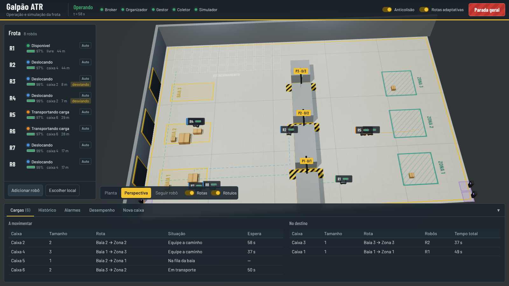

# Logística colaborativa com robôs móveis autônomos

Trabalho Final de **Automação em Tempo Real 2026/2** — UFMG, Escola de Engenharia, DELT. Prof. Leandro Freitas.

| Integrante | Matrícula |
|---|---|
| Felipe Santos Souza | 2021034652 |
| Davi Assis Silveira | 2022042632 |
| Gabriel Caldeira | 2022061645 |

Sistema completo (Etapas 1 e 2): um núcleo em C++17 que organiza uma frota de robôs — um processo por robô, threads de navegação e de status, organizador logístico, gestor de processos e coletor de dados, integrados por IPC — e, ligados a ele por MQTT, um simulador do galpão e uma tela de operação em 3D no navegador.



---

## Sumário

1. [Como rodar](#1-como-rodar)
2. [Usando a tela](#2-usando-a-tela)
3. [O que o sistema faz](#3-o-que-o-sistema-faz)
4. [Arquitetura](#4-arquitetura)
5. [Comunicação: IPC e MQTT](#5-comunicação-ipc-e-mqtt)
6. [Sincronização](#6-sincronização)
7. [Pontos extras](#7-pontos-extras)
8. [Requisitos do enunciado e onde são atendidos](#8-requisitos-do-enunciado-e-onde-são-atendidos)
9. [Testes e análise de escalonabilidade](#9-testes-e-análise-de-escalonabilidade)
10. [Organização do repositório](#10-organização-do-repositório)
11. [Problemas comuns](#11-problemas-comuns)

---

## 1. Como rodar

### Requisitos

| Ferramenta | Versão | Para quê |
|---|---|---|
| Linux (Ubuntu 22.04/24.04) ou WSL2 no Windows | — | IPC POSIX e System V |
| `g++` e `make` | C++17 (g++ 9 ou mais novo) | núcleo |
| Node.js e npm | 18 ou mais novo | broker MQTT, simulador e servidor da tela |
| Navegador com WebGL | Chrome, Edge ou Firefox recentes | tela 3D |
| Python 3 | opcional | só para os scripts que analisam os testes |

No Ubuntu ou no WSL2:

```bash
sudo apt update
sudo apt install -y build-essential git curl
# Node.js 20 (o pacote nodejs do Ubuntu 22.04 é antigo demais)
curl -fsSL https://deb.nodesource.com/setup_20.x | sudo -E bash -
sudo apt install -y nodejs
```

### Primeira execução

```bash
git clone https://github.com/felipesvm/projeto-final-atr.git
cd projeto-final-atr
./run.sh
```

Na primeira vez o `run.sh` compila o núcleo (`make`) e instala as dependências da interface (`npm install`, que precisa de internet uma única vez). Depois ele sobe, nesta ordem, o broker MQTT, o organizador, o coletor, o gestor e o simulador, e abre a tela em **http://localhost:8080**. Se o navegador não abrir sozinho (no WSL, por exemplo), abra o endereço manualmente.

`Ctrl+C` no terminal encerra tudo na ordem certa (simulador, gestor e robôs, coletor, organizador, broker) e remove os objetos de IPC.

### Opções do `run.sh`

| Opção | Padrão | Efeito |
|---|---|---|
| `--robos N` | 6 | Robôs que o simulador disponibiliza na partida. Outros podem entrar pela tela. |
| `--mapa-aleatorio` | — | Gera um galpão novo (paredes, passagens de capacidade 1 a 4, prateleiras e caixas sorteadas). |
| `--semente S` | — | Mapa aleatório reproduzível. |
| `--cenario arquivo` | `config/cenario.json` | Outro cenário (os de teste estão em `config/`). |
| `--n-max M` | 32 | Capacidade da tabela da frota. Só dimensiona o IPC; não exige recompilar. |
| `--porta-http P` | 8080 | Porta da tela. |
| `--mosquitto` | — | Usa o Mosquitto instalado no sistema (`config/mosquitto.conf`) em vez do broker embutido. |
| `--sem-interface` | — | Só o núcleo C++, com o driver local da Etapa 1 (sem MQTT, sem simulador). |
| `--sem-rt` | — | Não pede prioridades `SCHED_FIFO`. |
| `--nao-abrir` | — | Não abre o navegador. |

Para compilar separadamente: `make` (núcleo em `bin/`), `make testes` (testes de domínio), `make tsan` (versão com ThreadSanitizer em `bin-tsan/`), `make clean`.

### Prioridades de tempo real

As threads críticas usam `SCHED_FIFO` (navegação 80, status 75, E/S 70…). Sem permissão, o sistema avisa uma vez no terminal e roda com a política normal — funciona do mesmo jeito, só sem a garantia de prioridade. Para usar as prioridades sem rodar como root:

```bash
sudo setcap cap_sys_nice+ep bin/amr_robo bin/amr_organizador
```

(repita depois de cada `make`, porque a compilação recria os executáveis).

## 2. Usando a tela

A tela é ao mesmo tempo a **tela de operação** e a **interface do simulador** (o enunciado permite as duas juntas).

| Área | O que mostra e o que permite |
|---|---|
| Galpão 3D | Robôs com a cor do estado no anel de LED, rótulo com identificador e bateria, cargas sobre as equipes, caixas nas baias (fila) e nas zonas (entregues), passagens com placa de ocupação (por exemplo `P2 · 1/2`) e semáforo no pórtico, rotas planejadas tracejadas. |
| Câmera | **Planta** (vista superior 2D, a do enunciado), **Perspectiva** (girar com o botão esquerdo, arrastar com o direito, zoom na roda) e **Seguir robô**. |
| Frota (esquerda) | Estado, modo, bateria, tarefa e distância de cada robô. Clique para selecionar. **Adicionar robô** disponibiliza um robô novo no estacionamento; **Escolher local** deixa você clicar no piso. |
| Robô selecionado (direita) | Posição, setpoint, bateria, missão, processo, supervisão e métricas da `T_NAV`. **Modo automático/manual**: em manual, envie o robô a uma baia, zona ou estação de recarga, ou clique em *Escolher destino no piso* e depois em qualquer ponto do mapa. **Parar, Retomar, Reconhecer falha, Abortar missão.** Em *Simulação do hardware*: gerar ou remover defeito, cortar a comunicação e ajustar a bateria. |
| Topo | Estado do sistema, processos conectados ao broker, chaves de **anticolisão** e **rotas adaptativas** (pontos extras), **Parada geral**. |
| Painel inferior | **Cargas** (a movimentar e já no destino, com robôs e tempo total), **Histórico** (registros do coletor, com data e hora), **Alarmes**, **Desempenho** (entregas, tempo médio, intervenções da anticolisão, colisões, prazos perdidos, métricas de tempo real por robô e ocupação das passagens) e **Nova caixa** (inclui uma caixa na fila de uma baia). |

`Esc` cancela a escolha de um ponto no piso.

## 3. O que o sistema faz

Cada baia começa com uma fila fixa de caixas de tamanhos 1 a 4; o tamanho é o número de robôs que a caixa exige. O organizador escolhe a próxima caixa de cada baia, forma uma equipe com os robôs livres mais baratos de mandar (pelo caminho real e pela bateria), e só libera a carga quando todos estão em posição. Os robôs acoplam no mesmo instante, levam a carga em formação até a zona de destino, desacoplam juntos e o coletor registra a entrega.

Enquanto isso, o sistema reage a eventos a qualquer momento:

- **robô novo** (pela tela): o simulador anuncia por MQTT, o gestor cria o processo, o organizador passa a usá-lo;
- **defeito** (pela tela): o robô para no ciclo seguinte; se estava em equipe, todos depositam a carga ao mesmo tempo e a caixa volta ao despacho a partir de onde ficou;
- **bateria baixa ou crítica**: a `T_STATUS` atribui a estação de recarga mais próxima; o robô termina a missão (baixa) ou a aborta (crítica), recarrega até 95 % e volta ao trabalho;
- **passagem cheia**: o robô encosta ao lado da entrada e espera a vaga, sem bloquear a sua thread;
- **perda de comunicação**: quadro de sensores com mais de 250 ms põe o robô em `SEM_COMUNICACAO`, parado;
- **comandos do operador**: modo manual/automático, destino manual, parar, retomar, abortar, parada geral.

Robôs livres voltam sozinhos para a sua vaga no estacionamento.

## 4. Arquitetura

```
 navegador (tela 3D) ──── MQTT/WebSocket ────┐
                                             │
                          ┌──────────────────┴─────────────────┐
                          │  broker MQTT (Node.js/aedes ou     │
                          │  Mosquitto) — TCP 1883, WS 9001     │
                          └──┬──────────┬──────────┬────────┬───┘
       amr/hw/<id>/sensores  │          │          │        │  amr/sup/estado, amr/cmd/#
       amr/hw/<id>/atuadores │          │          │        │
 ┌───────────────────────────┴───┐  ┌───┴────────┐ │  ┌─────┴──────────────────────────┐
 │ simulador (Node.js)           │  │ amr_gestor │ │  │ amr_organizador (dono do IPC)  │
 │ física 50 ms, mapa, watchdog, │  │ ANUNCIO    │ │  │ T_ORG_EVT  evento   P65        │
 │ colisões, comandos de simul.  │  │ SPAWN      │ │  │ T_ORG_DESP 200 ms   P60        │
 │ servidor HTTP da tela         │  │ REAP       │ │  │ T_ORG_SUP  500 ms   P55        │
 └───────────────────────────────┘  └─────┬──────┘ │  │ T_ORG_HMI  200 ms   P35 (MQTT) │
                                fork+execv │        │  └──┬───────────┬─────────────────┘
                          ┌────────────────┴──────┐ │     │ filas     │ /amr_frota (shm)
                          │ amr_robo × N          │◀┼─────┘ POSIX     │ semáforos SysV
                          │ T_NAV    50 ms  P80   │ │                 │
                          │ T_STATUS 100 ms P75   │─┼─────────────────┘
                          │ T_IO (MQTT)    P70    │ │
                          │ T_ROTA (A*)    P40    │ │   /amr_eventos (buffer circular)
                          └───────────┬───────────┘ │            │
                                      └─────────────┼────────────▼────────────┐
                                                    │ amr_coletor             │
                                                    │ T_COL_CONS, T_COL_SNAP, │
                                                    │ T_COL_PUB (MQTT)        │
                                                    └──── logs/<data>/*.csv ──┘
```

| Processo | Linguagem | Instâncias | Função |
|---|---|---|---|
| `amr_organizador` | C++17 | 1 | Cria e remove o IPC; despacho, reunião das equipes, supervisão, ponte MQTT com a tela. |
| `amr_gestor` | C++17 | 1 | Recebe o anúncio de robôs novos por MQTT, cria um processo por robô (`fork` + `execv`), detecta término (`waitpid`). |
| `amr_robo` | C++17 | N | Navegação, status, planejamento de rota, E/S com o hardware simulado e anticolisão. |
| `amr_coletor` | C++17 | 1 | Grava em disco, com data e hora, cada carga e o histórico de cada robô; publica os registros para a tela. |
| `broker.js` | Node.js | 1 | Broker MQTT (aedes) em TCP e WebSocket. Pode ser trocado pelo Mosquitto. |
| `simulador.js` | Node.js | 1 | Hardware de cada robô, mapa, geração de eventos, servidor da tela. |
| Tela | JavaScript + Three.js | navegador | Tela de operação e de simulação em 3D, cliente MQTT direto do navegador. |

### Threads e requisitos temporais

| Thread | Período | Prioridade | Função |
|---|---|---|---|
| `T_NAV` | 50 ms | 80 | Setpoints, passagens, formação, acoplamento em `t_go`, anticolisão. Nunca bloqueia. |
| `T_STATUS` | 100 ms | 75 | Defeito, bateria (e destino de recarga), comunicação, distância, publicação do slot. |
| `T_IO` | 200 ms ou saída nova | 70 | `DriverMQTT`: recebe `amr/hw/<id>/sensores`, publica `amr/hw/<id>/atuadores`. |
| `T_ROTA` | evento | 40 | A* com custo adaptativo das passagens, calculado com a trava solta. |
| `T_ORG_EVT` | evento | 65 | Fila de entrada do organizador: eventos dos robôs, do gestor e da tela. |
| `T_ORG_DESP` | 200 ms | 60 | Abastece as baias e forma equipes. |
| `T_ORG_SUP` | 500 ms | 55 | *Watchdog* de *heartbeat*, prazos de reunião e acoplamento, alarmes. |
| `T_ORG_HMI` | 200 ms | 35 | Publica o estado do galpão e converte comandos da tela em mensagens da fila. |
| `T_GES_*`, `T_COL_*` | evento / 1 s | normal | Anúncios, criação e coleta de processos; gravação, amostragem e publicação dos registros. |

Todas as tarefas periódicas usam `TarefaPeriodica` (`src/comum/tarefa_periodica.*`): liberação em instante absoluto (`clock_nanosleep` com `TIMER_ABSTIME`), medição do tempo de execução e do atraso de liberação, e descarte de liberações perdidas. As métricas aparecem na aba *Desempenho* e em `frota.csv`.

## 5. Comunicação: IPC e MQTT

**Entre os processos C++ (mesma máquina):**

| Objeto | Mecanismo | Uso |
|---|---|---|
| `/amr_frota` | memória compartilhada POSIX | Status de cada robô (escritor único: a `T_STATUS` dele), equipes, espelho das passagens, `parada_geral` atômica. |
| `/amr_cmd_<id>` | fila POSIX por robô, com prioridade | Organizador → robô: `PARAR`, `ABORTAR` (31), `MODO`, `RETOMAR` (20), `DESTINO_MANUAL` (15), `MISSAO_EQUIPE` (10)… |
| `/amr_org_inbox` | fila POSIX | Robôs, gestor e tela → organizador. |
| semáforos System V | um por passagem | Vagas livres; `semop(-k, IPC_NOWAIT)` toma *k* vagas de uma vez. |
| `/amr_eventos` | buffer circular em shm + semáforos POSIX nomeados | Todos → coletor (produtor–consumidor). |

**MQTT** (QoS 0 para estado periódico, QoS 1 para eventos e comandos; *last will* em `amr/status/<processo>`):

| Tópico | De → para | Conteúdo |
|---|---|---|
| `amr/sim/robo_novo` | simulador → gestor | `hw_id`, posição inicial |
| `amr/hw/<id>/sensores` | simulador → robô (20 Hz) | `i_posicao_x`, `i_posicao_y` (cm), `i_carga_atracada`, `i_percentual_bateria`, `i_falha` — as variáveis da Tabela 1 |
| `amr/hw/<id>/atuadores` | robô → simulador | `o_sp_posicao_x`, `o_sp_posicao_y` (cm), `o_acoplar_e_erguer` |
| `amr/robo/<id>/rota` | robô → tela | waypoints restantes |
| `amr/sim/mapa`, `amr/sim/estado` | simulador → tela | mapa (retido); posições físicas a 10 Hz e colisões |
| `amr/sim/cmd` | tela → simulador | defeito, bateria, comunicação, robô novo, caixa nova |
| `amr/sim/caixa_nova` | simulador → organizador | caixa incluída numa baia |
| `amr/sup/estado`, `amr/sup/alarme` | organizador → tela | estado do galpão a 5 Hz (robôs, equipes, passagens, caixas, indicadores); alarmes |
| `amr/cmd/operador` | tela → organizador | modo, destino, parar, retomar, reconhecer, abortar, parada geral, chaves dos extras |
| `amr/log/evento`, `amr/log/pedido`, `amr/log/historico` | coletor ↔ tela | registros do coletor e histórico sob pedido |

O cliente MQTT do núcleo é uma implementação própria do protocolo 3.1.1 (`src/comum/mqtt.*`), sem dependências: CONNECT com *last will*, PUBLISH QoS 0 e 1, SUBSCRIBE, PINGREQ e reconexão automática. Os callbacks só copiam dados para estruturas protegidas por trava; nenhuma thread de tempo real faz E/S de rede.

## 6. Sincronização

| Problema | Solução |
|---|---|
| Passagem que comporta *c* robôs | Semáforo de contagem System V com valor *c*. Robô sozinho toma 1 vaga, equipe de *k* toma *k* numa só operação atômica (`semop`, `IPC_NOWAIT`); passagens consecutivas são tomadas juntas. As vagas só voltam quando todos os robôs estão, pela posição medida, fora da passagem. |
| Inanição na passagem | Quem espera há mais de 2 s fica registrado e os outros cedem a vez; após 20 s, rota alternativa. |
| Carga liberada só com todos em posição | Contagem de chegadas (*rendezvous*) na `T_ORG_EVT`. |
| Acoplamento síncrono | O organizador grava `t_go = agora + 100 ms` no slot da equipe; cada `T_NAV` aciona `o_acoplar_e_erguer` no primeiro ciclo com `t ≥ t_go`. Mesmo mecanismo para desacoplar e para depositar a carga num aborto. |
| Formação | Barreira não bloqueante por waypoint (máscara de bits sob o mutex da equipe). |
| Status compartilhado | Mutex por slot, compartilhado entre processos, robusto (`EOWNERDEAD`) e com herança de prioridade. |
| Eventos para o coletor | Produtor–consumidor com `sem_vazios`, `sem_itens` e mutex; produtores de tempo real nunca bloqueiam. |
| E/S, rota e criação de processos | Mutex + variável de condição (`cv_out`, `cv_rota`, `cv_spawn`) com predicado. |
| Parada de emergência | Variável atômica `parada_geral`, lida sem trava a cada ciclo da `T_NAV`. |

Hierarquia de travas: equipe (N1) → slot do robô / espelho da passagem (N2) → `mtx_modelo`, `mtx_nav` (N3) → imagem de E/S, rota visível (N4) → buffer de eventos, console (N5). O organizador decide sob `mtx_modelo` e só depois, sem ele, escreve nas equipes e nos slots.

## 7. Pontos extras

### Anticolisão descentralizada (até +2)

Cada robô decide sozinho, dentro da própria `T_NAV`, sem nenhuma mensagem ao organizador (`Anticolisao` em `src/robo/dominio.hpp`, aplicada em `navegacao.cpp`):

1. lê as posições dos vizinhos direto da tabela da frota e estima a velocidade de cada um pela diferença entre duas publicações;
2. calcula o ponto de maior aproximação nos próximos 2 s; abaixo de 0,65 m entre centros há conflito;
3. no conflito, quem tem menor prioridade espera (robô carregando carga tem prioridade, depois o menor identificador); robô parado no caminho é contornado por um ponto lateral livre — de paredes, de passagens e de outros robôs — sempre pelo mesmo lado;
4. com carga, a equipe não sai da formação: só espera. Na entrada de uma passagem cheia, o robô sozinho encosta ao lado para não ficar no caminho de quem sai;
5. se continuar preso atrás de um robô parado, pede ao `T_ROTA` outra rota. O planejador também evita, desde o início, as células com robôs parados.

O simulador conta colisões (centros a menos de 35 cm, exceto robôs acoplados à mesma carga) e a tela mostra o total junto com o número de intervenções da anticolisão. A chave **Anticolisão** no topo liga e desliga o módulo em tempo real, para comparar os dois casos.

### Inteligência artificial para rotas e cargas, com mapa aleatório (até +3)

- **Mapa aleatório a cada execução** (`./run.sh --mapa-aleatorio`): `bin/gerar_mapa` sorteia duas paredes com quatro passagens cada, de capacidades 1, 2, 3 e 4, prateleiras e filas de caixas. Um mapa só é aceito se todas as baias chegam a todas as zonas com equipes de 1 a 4 robôs e se o estacionamento e as estações de recarga são alcançáveis.
- **Rotas por busca heurística com custo aprendido**: o A* de cada robô soma ao comprimento do caminho um custo por passagem, igual à média móvel das esperas que os próprios robôs observaram ali, mais uma penalidade se ela está cheia agora. Passagens congestionadas ficam "mais longas" e o tráfego se redistribui sozinho. Equipes só usam passagens com capacidade maior ou igual ao seu tamanho. A chave **Rotas adaptativas** liga e desliga o custo aprendido.
- **Otimização da atribuição de cargas**: o despachante escolhe os robôs pelo caminho real até a caixa (busca em largura na grade a partir da caixa) e pela bateria, e não pela distância em linha reta; mantém a alocação tudo-ou-nada, o envelhecimento das caixas e a reserva progressiva contra inanição.
- **Pontos de descarga em rodízio** e retorno automático ao estacionamento evitam que equipes seguidas parem umas sobre as outras.

## 8. Requisitos do enunciado e onde são atendidos

| Requisito | Onde |
|---|---|
| Gestor de Robôs em C/C++, novo robô anunciado por MQTT, processo novo, aviso ao organizador | `src/gestor/` (`T_GES_ANUNCIO` assina `amr/sim/robo_novo`; `fork` + `execv`; `NOVO_ROBO`) |
| Robô em posição fixa ou arbitrária | estacionamento ou *Escolher local* na tela |
| Processo por robô com pelo menos duas threads | `src/robo/` (quatro threads de aplicação) |
| Comando de navegação: tarefa → setpoints, troca com o status, passagens estreitas seguras | `navegacao.cpp`, semáforos System V |
| Status: buffer compartilhado, falha para o robô, bateria → destino de recarga, distância total | `status.cpp`, `/amr_frota` |
| Organizador: caixas de tamanhos 1–4 em fila fixa não ordenada por baia, escolha da caixa e dos robôs, liberação com todos em posição, IPC com os robôs, MQTT com a tela | `src/organizador/` |
| Tela: posição dos robôs, caixas a mover e entregues, status em tempo real, manual/automático, destino manual arbitrário ou por local | `interface/web/` |
| Coletor: baia, destino e robôs de cada carga; histórico de cada robô; data e hora; disco e operação remota | `src/coletor/`, `logs/<data>/`, `amr/log/*` |
| Simulação: hardware dos robôs, mapa com baias e zonas, passagens de 1, 2 e 3 robôs, interface gráfica para gerar defeitos, baixar baterias, incluir caixas e robôs | `interface/simulador.js`, `interface/sim/`, tela |
| Variáveis da Tabela 1 | payloads de `amr/hw/<id>/sensores` e `atuadores` |
| Tudo a partir de um único arquivo, caminhos relativos | `./run.sh` |
| Testes de cada módulo e das interações | `testes/` |

## 9. Testes e análise de escalonabilidade

```bash
make testes                                      # T-01: domínio (A*, despachante, anticolisão, bateria...)
bash testes/integracao/t13_mqtt.sh               # sistema completo por MQTT: comandos da tela e da simulação
bash testes/integracao/executar_todos.sh         # T-01 a T-13 (cerca de 1 h)
VALORES="2 4 8 16 24 32" bash testes/integracao/escalabilidade.sh
```

| ID | O que verifica |
|---|---|
| T-01 | Lógica de domínio isolada (27 casos). |
| T-02 | Ausência de condições de corrida com ThreadSanitizer. |
| T-03 | Leitura íntegra do status de cada robô pela tabela da frota. |
| T-04 | Prioridade de `PARAR` na fila do robô; nada perdido ou duplicado. |
| T-05 | Um processo por robô até N_max e detecção de `kill -9`. |
| T-06 | Ocupação das passagens nunca acima da capacidade. |
| T-07 | Dispersão entre os acoplamentos dos membros de cada equipe (≤ 60 ms). |
| T-08 | Despacho tudo-ou-nada, envelhecimento, caixa maior que a frota. |
| T-09 | Robôs mortos segurando o mutex do slot (`EOWNERDEAD`). |
| T-10 | Coletor pausado com `SIGSTOP`. |
| T-11 | Defeito → setpoint congelado em até dois ciclos da `T_NAV`. |
| T-12 | Frota de tamanho variável, N = 1 a 16. |
| T-13 | Sistema completo por MQTT: 13 verificações de comandos da tela e da simulação. |

Os testes T-02 a T-12 rodam o núcleo com o driver local (`--sem-interface`), para isolar o IPC e a sincronização; o T-13 e a rampa de escalabilidade rodam o sistema completo. As evidências ficam em `testes/resultados/`. A rampa grava, para cada N, entregas, colisões, intervenções da anticolisão, prazos perdidos e os maiores tempos de execução e de atraso de liberação das threads críticas — a base para responder qual o maior número de robôs que o hardware gerencia com corretude e responsividade.

## 10. Organização do repositório

```
run.sh                  inicia o sistema inteiro
Makefile                núcleo C++ (make, make testes, make tsan)
config/                 cenário padrão, cenários de teste, mosquitto.conf
src/comum/              IPC, MQTT, tabela da frota, protocolo, tarefa periódica, cenário e A*
src/robo/               amr_robo: navegação, status, rota, drivers (MQTT e local), domínio
src/organizador/        amr_organizador: eventos, despacho, supervisão, ponte com a tela (hmi.cpp)
src/gestor/             amr_gestor
src/coletor/            amr_coletor
ferramentas/            gerar_mapa, amr_monitor, injetar_evento, anunciar_robo, limpar_ipc, rajada_comandos
interface/broker.js     broker MQTT
interface/simulador.js  simulador e servidor da tela; física em interface/sim/
interface/web/          tela 3D (Three.js)
interface/ferramentas/  scripts de teste por MQTT
testes/                 testes de domínio e de integração
third_party/            nlohmann/json (MIT)
```

## 11. Problemas comuns

| Sintoma | O que fazer |
|---|---|
| `Node.js não encontrado` ou erro de sintaxe no simulador | Instale o Node 18 ou mais novo (seção 1). `node --version` deve mostrar v18+. |
| Porta 1883, 9001 ou 8080 em uso | Encerre o outro serviço (por exemplo `sudo systemctl stop mosquitto`) ou use `--porta-http`. |
| Tela abre mas fica "Conectando" | O navegador precisa alcançar a porta 9001 (WebSocket do broker) na mesma máquina. |
| Aviso "sem permissão para SCHED_FIFO" | Normal sem privilégios; veja *Prioridades de tempo real*. |
| Execução interrompida deixou lixo de IPC | `./bin/limpar_ipc` (o `run.sh` também limpa ao iniciar). |
| WSL: navegador não abre sozinho | Abra http://localhost:8080 no navegador do Windows. |
| 3D lento | Use a câmera *Planta*, desligue *Rótulos* e *Rotas*, ou um navegador com aceleração de hardware ativa. |
